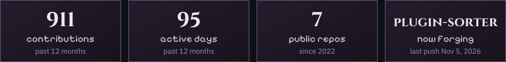
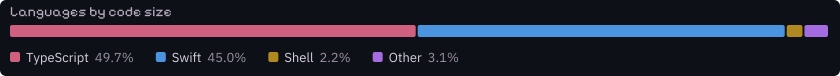
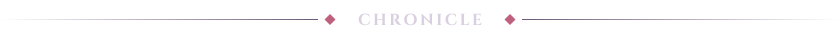
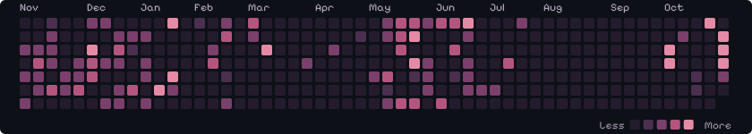
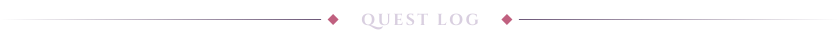
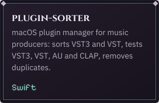
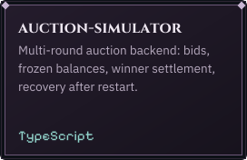
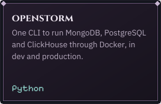
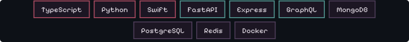
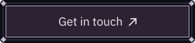

<picture><source media="(prefers-color-scheme: light)" srcset="assets/title-light.svg"></picture>

<picture><source media="(prefers-color-scheme: light)" srcset="assets/divider-sheet-light.svg"></picture>

<picture><source media="(prefers-color-scheme: light)" srcset="assets/divider-chronicle-light.svg"></picture>

<picture><source media="(prefers-color-scheme: light)" srcset="assets/divider-quests-light.svg"></picture>

  
  
  

<picture><source media="(prefers-color-scheme: light)" srcset="assets/divider-inventory-light.svg"></picture>

  

